<div align="center">

# How To Use

[简体中文](/assets/doc/zh/How_to_use.md) | **English**

[*项目说明*](/README.md) | [*常见问题*](/assets/doc/zh/FAQ.md) | [*README*](/assets/doc/en/README_EN.md) | [
*FAQ_EN*](/assets/doc/en/FAQ_EN.md)

</div>

<div align="center">

You can use the **CTRL+Q** keys to terminate the script process during script execution (this may cause problems when
the script starts again, which can be solved by restarting the script program)

You can use the **ALT+P** keys to pause the script and the **ALT+R** keys to resume the script

The method of using the simulator is at the [bottom of this article](#simulator-usage)

For additional support regarding external scripts, please refer to [Third-Party Script Support](#third-party-script-support)

</div>

---

## Main Window

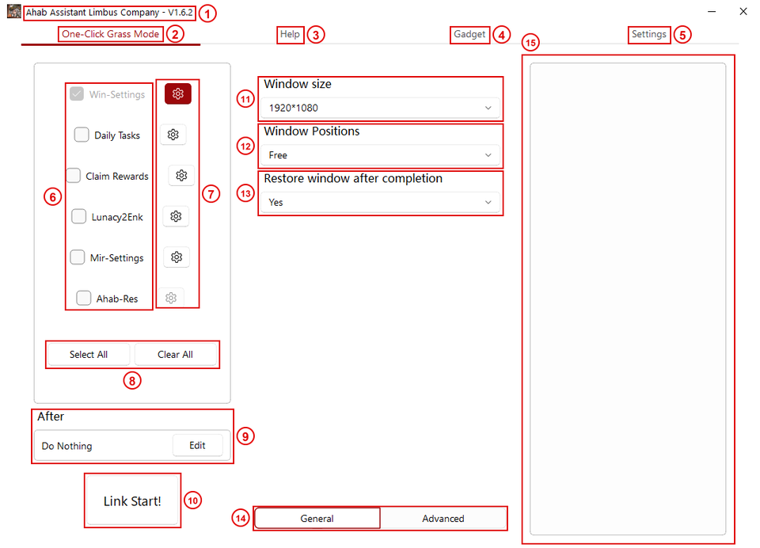

#### ① The current AALC version. Please include it when opening an issue

#### ② One-Click Grass Mode: the main page, where all automation tasks are configured and started

#### ③ Help: the document you are reading now

#### ④ Gadget: small standalone tools

#### ⑤ Settings: other settings, such as emulator, auto Hard Mirror, how teams are chosen (by team name or by index), hotkeys, updates, etc.

#### ⑥ Select the tasks to run on start (Win-Settings always runs; Ahab-Res currently has nothing to configure)

#### ⑦ Click a gear to open that task's settings page (each page is explained below)

#### ⑧ Select or clear all tasks

#### ⑨ What to do after all tasks finish. Click "Edit" to change it, see [After](#after)

#### ⑩ Start the selected tasks. While running it becomes a stop button, and a pause button appears next to it

#### ⑪ Game window size. Choose according to your PC (1920\*1080 or 2560\*1440 recommended)

#### ⑫ Game window position. "Free" leaves the window where it is; any other option moves the window there and removes its title bar

#### ⑬ Restore window after completion: restore the game window's title bar and remove always-on-top when tasks finish

#### ⑭ Every task settings page has a "General" and an "Advanced" part

#### ⑮ Log

##### Tips: when Window Positions is "Free", Restore window after completion has no effect

---

### Win-Settings · Advanced

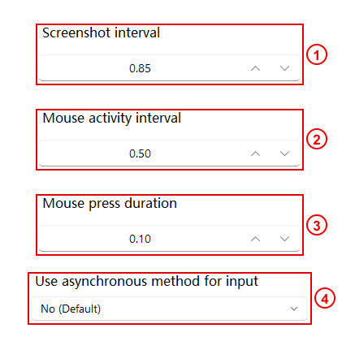

#### ① Screenshot interval: minimum time between two screenshots (seconds)

#### ② Mouse activity interval: minimum time between two mouse actions (seconds)

#### ③ Mouse press duration: how long the mouse button is held down; only used when ④ is "Yes"

#### ④ Use asynchronous method for input: clicks faster, but may miss clicks on slower PCs or networks

The defaults are fine for most users; increase ① and ② a little on a slow PC.

---

### After

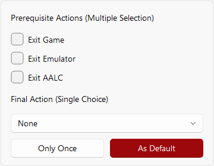

Click "Edit" next to "After" on the main page:

- **Prerequisite Actions (multiple)**: Exit Game, Exit Emulator (emulator mode only), Exit AALC
- **Final Action (single)**: None, Sleep, Hibernate, Lock, Shutdown (shutdown happens after 30 seconds)
- **Only Once**: applies to this run only, and resets to "None" when AALC restarts
- **As Default**: applies after every run

Prerequisite actions run first, then the final action. If another scheduled task is still waiting, the actions are skipped this time.

---

## Daily Tasks

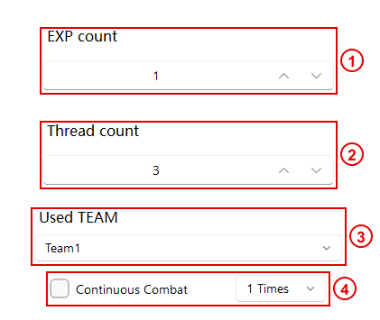

#### ① EXP count

#### ② Thread count (EXP luxcavations run first, then Thread)

#### ③ The team used for both EXP and Thread luxcavations

#### ④ Continuous Combat. The box on the right sets the maximum battles in one go. For example, 5 runs with a maximum of 3 become 3 + 2

### Daily Tasks · Advanced

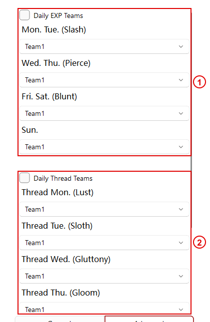

#### ① Daily EXP Teams: set a team for each weekday's EXP luxcavation; when unchecked, the team from General is used

#### ② Daily Thread Teams: set a team for each weekday's Thread luxcavation; when unchecked, the team from General is used

---

## Claim Rewards


Check the rewards to claim (multiple allowed). If nothing is checked, this task is skipped.

#### ① Daily/Weekly: claim daily, weekly and season pass mission rewards

#### ② Battle Pass Rewards: click "Claim All" on the battle pass page

#### ③ Mail: click "Claim All" in the mailbox

---

## Lunacy2Enk

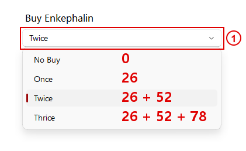

#### ① How many lunacy-to-enkephalin exchanges to make each day. "Twice" means the 1st and 2nd exchange of the day; exchanges already made today are not repeated. Each exchange costs 26, 52 and 78 lunacy; the red numbers show the total cost

### Lunacy2Enk · Advanced

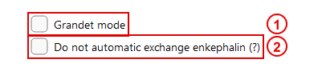

#### ① Grandet mode: only exchange when the next enkephalin point still needs more than 5:20 to regenerate, so no regeneration progress is wasted

#### ② Do not automatic exchange enkephalin: after battles and Mirror Dungeons, do not convert stamina into enkephalin modules (the Lunacy2Enk task itself still does)

---

## Mir-Settings

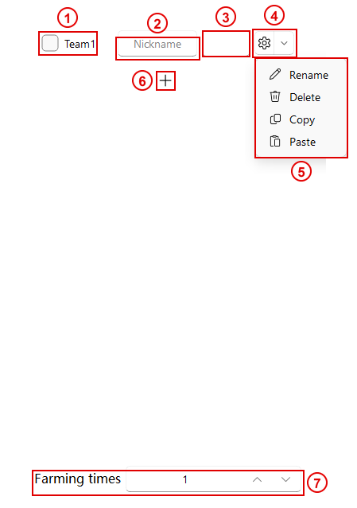

#### ① Check to enable this team. Enabled teams are queued in the order they were checked and take turns in the Mirror Dungeon

#### ② Nickname of this team, for display only; can be changed in ⑤

#### ③ This team's current position in the queue. Each run uses the first team, which then moves to the end

#### ④ Click the gear to open this team's [Team Settings](#team-settings)

#### ⑤ Click the arrow next to the gear: Rename, Delete (at least one team must remain), Copy, Paste (copy one team's settings to another)

#### ⑥ Add a team: create an empty one, or create one from an exported configuration file

#### ⑦ Farming times: how many Mirror Dungeon runs to complete

### Mir-Settings · Advanced

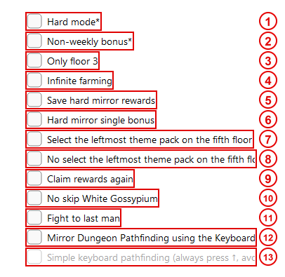

#### ① Hard mode\*: run every Mirror Dungeon on Hard

#### ② Non-weekly bonus\*: do not use the weekly bonus when collecting rewards

The two options marked \* only last for the current run and are cleared when AALC restarts; **right-click** to make them permanent. With "Auto change Hard Mirror" enabled in Settings, AALC runs Hard Mirror automatically after the weekly reset and controls ① itself

#### ③ Only floor 3: give up the run when floor 4 is reached

#### ④ Infinite farming: ignore Farming times and keep running

#### ⑤ Save hard mirror rewards: Hard Mirror only. Runs once and collects the rewards without spending enkephalin, so they are saved

#### ⑥ Hard mirror single bonus: use only one weekly bonus when collecting rewards

#### ⑦ Select the leftmost theme pack on the fifth floor

#### ⑧ No select the leftmost theme pack on the fifth floor: choose from the other packs by weight (if both ⑦ and ⑧ are checked, ⑦ wins)

#### ⑨ Claim rewards again: run the Claim Rewards task after the first Mirror Dungeon and again after all runs finish

#### ⑩ No skip White Gossypium: by default the Bleed gift "White Gossypium" is skipped; check to stop skipping it

#### ⑪ Fight to last man: by default the run is given up and restarted when a sinner dies or too few sinners can fight; check to keep fighting

#### ⑫ Mirror Dungeon Pathfinding using the Keyboard: use arrow keys instead of mouse clicks to pick the next node

#### ⑬ Simple keyboard pathfinding: always press ↑ and never drag the map, falling back to normal pathfinding if it fails; requires ⑫

---

## Team Settings

Click a team's gear in Mir-Settings, and a "Team Settings" page appears at the top:

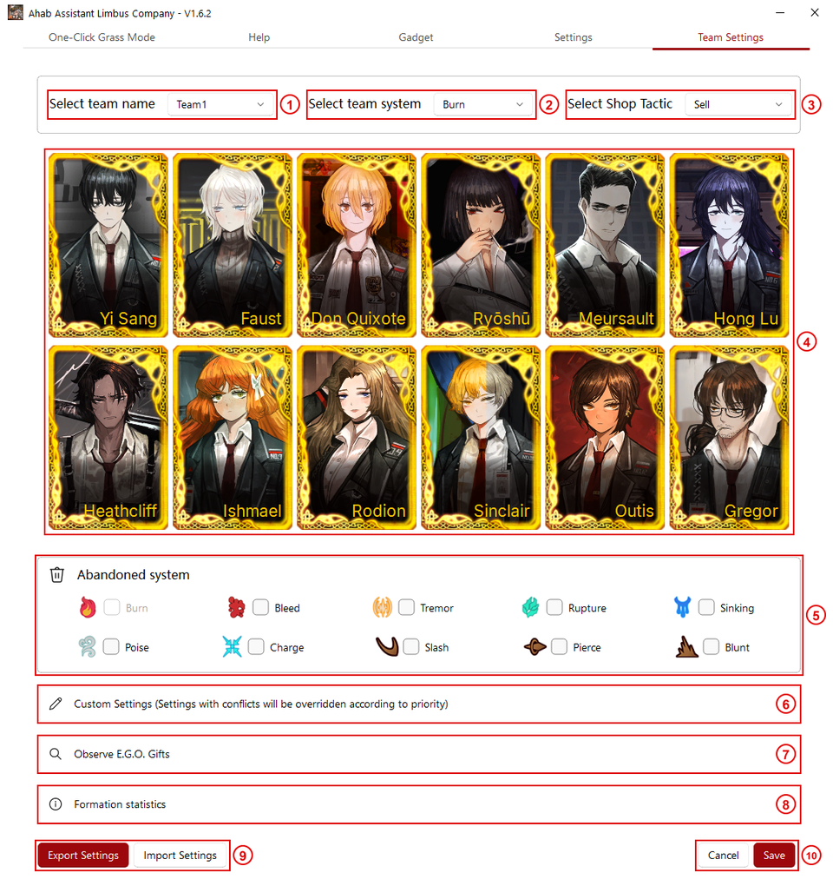

#### ① Select team name: which in-game team to use (Team1 is "TEAMS #1" in the game). Keep the in-game team names at their defaults; if you renamed them, set "Choose teams way" to "Using Index" in Settings

#### ② Select team system: which keyword system to prefer when getting, buying and fusing gifts

#### ③ Select Shop Tactic: Sell (no fusing, sell useless gifts), Fuse, Fuse: Level IV First (fuse this system's level IV gift first)

#### ④ Click sinners to add them, numbered in click order: the first 7 are deployed (SELECTED), the rest are backups (BACKUP)

#### ⑤ Abandoned system: gifts of the checked systems are sold, or used as fusing material

#### ⑥ Custom Settings, see the image below

#### ⑦ Observe E.G.O. Gifts: after enabling observation, pick up to 3 gifts to observe at the start by system, tier, row and column

#### ⑧ Formation statistics: number of runs and average time for this team

#### ⑨ Export Settings / Import Settings: save this team's settings (including theme pack weights) to a file, or load them from a file

#### ⑩ Cancel / Save: changes only take effect after "Save"

### Custom Settings

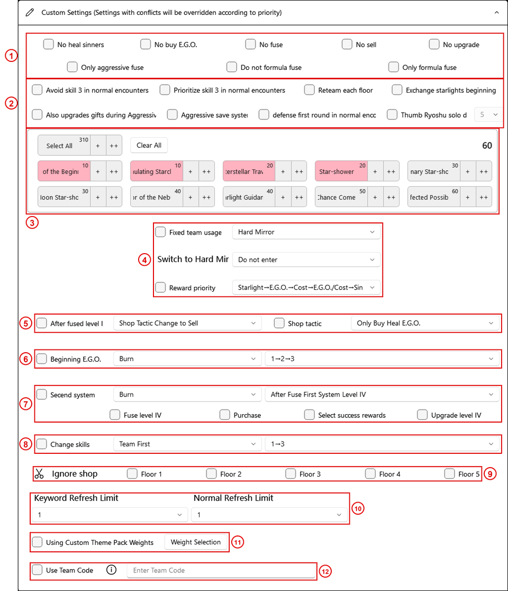

#### ① Shop and fusing: No heal sinners, No buy E.G.O., No fuse, No sell, No upgrade; Only aggressive fuse, Do not formula fuse, Only formula fuse

#### ② Battle and run flow:

- Avoid / Prioritize skill 3 in normal encounters (pick one)
- Reteam each floor: re-form the team after choosing each floor's theme pack
- Exchange starlights beginning: convert starlight into cost when entering
- Also upgrades gifts during Aggressive Fuse; Aggressive save systems gift (don't use this system's gifts as material during aggressive fusing)
- Defense first round in normal encounters / Thumb Ryoshu solo defense (pick one): the latter defends with everyone for several turns in each run; choose the number of turns on the right

#### ③ Starting starlight: the starlight bonuses to pick before entering; the total cost is shown at the top right

#### ④ Fixed team usage: use this team only for Hard or Normal Mirror; Switch to Hard Mirror Dungeon on Floor: switch to hard theme packs from that floor; Reward priority: the order for picking reward cards

#### ⑤ After fused level IV: after fusing this system's level IV gift, switch to selling, normal fusing, fusing the second system's level IV gift, or skipping shops; Shop tactic: which gifts to buy in the shop

#### ⑥ Beginning E.G.O.: choose the starting gift system and pick order

#### ⑦ Second system: a second keyword system, when to start using it, and what to do with it (fuse level IV, purchase, upgrade level IV, etc.)

#### ⑧ Change skills: replace skills of the chosen sinners in the shop

#### ⑨ Ignore shop: skip shop actions on the checked floors

#### ⑩ Keyword / Normal Refresh Limit: maximum refreshes per shop

#### ⑪ Using Custom Theme Pack Weights: use this team's own theme pack weights; set them with "Weight Selection"

#### ⑫ Use Team Code: load a team code in the game. This overwrites the in-game team and may be unstable in background mode

---

# Simulator Usage

In the Settings screen, turn on the "Use Emulator" option, and it is recommended to use the MUMU emulator.

### Selection and Acquisition of Emulator Port Number

#### mumu emulator: menu bar in the upper right corner of the emulator - Problem diagnosis - find "ADB debug port"

- If using the default port number 0, the default initial emulator will be used

#### Other emulators: find the port number according to your own situation, the following are some default ports

- LDPlayer Simulator 5555
- BlueStacks Simulator 5555
- MEmu Simulator 21503
- NOX Simulator 62001 / 59865

### Note

- Different emulators may have different port numbers, which need to be selected according to the actual situation
- Some emulators may require enabling adb port debugging in settings, such as BlueStacks Simulator, LDPlayer Simulator
- Some emulators may require disabling "Application Keep Alive" in settings, such as MUMU Simulator.(Auto-off
  configured, but may not work)
- When using an emulator, you need to make sure that the emulator's resolution is consistent with the resolution set
  in "Windows Setting" in AALC
- Emulators may cause the script to run slowly, so it is recommended to use a higher configuration computer and give the
  emulator enough memory and CPU resources

### Third-Party Script Support

## Command Line Launch

Launch method:

```ps1
# < > indicates required content
# [ ] indicates optional parameters
# Parameters without brackets should be filled according to the corresponding command description
AALC.exe <command_name> command_args extra_args

# The following examples omit "AALC.exe"
```

Currently supported commands:

- `start [--exit [int]]`
  - `start`
    AALC will automatically run tasks after startup; tasks need to be set in advance
  - `[--exit]` Optional parameter, comes with an additional parameter
    - `[int]` An integer string representing the index of the `combobox` on the AALC One-Click Grass interface. If not specified, the default is `5`, which means **Exit AALC**

Example: `AALC.exe start --exit 6`

In the current version, this will exit both AALC and the game after completion.
