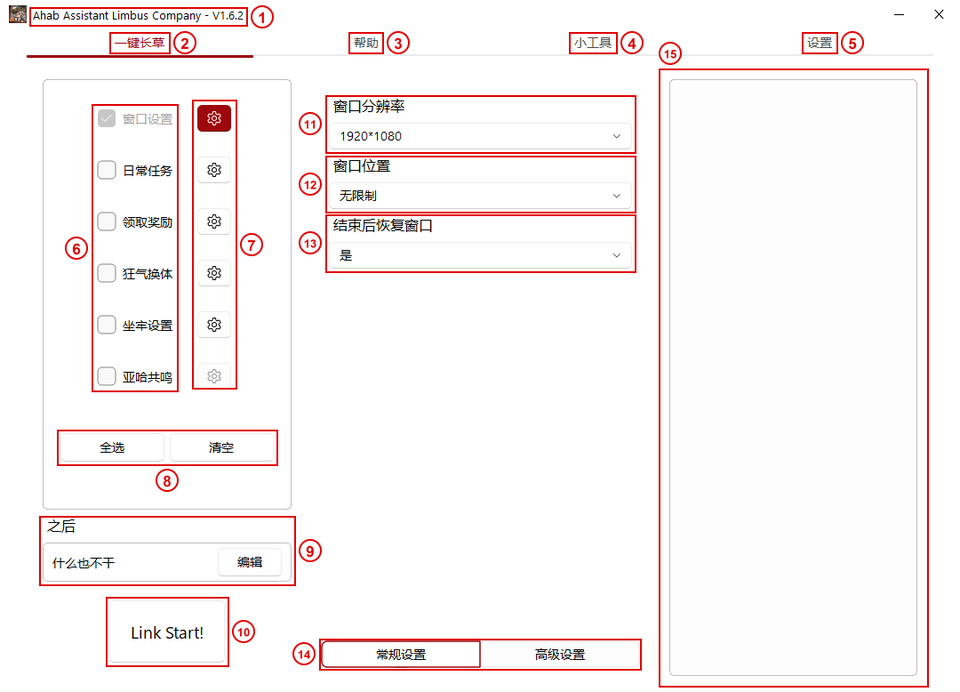
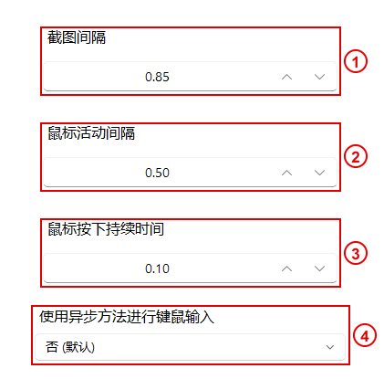
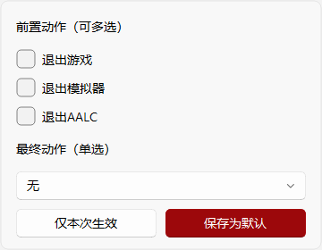
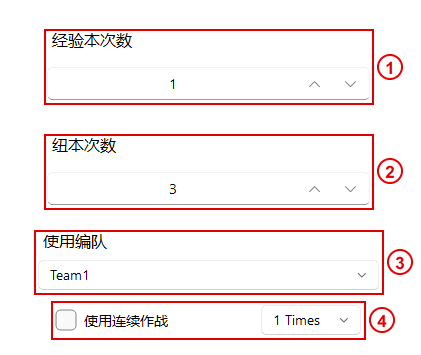
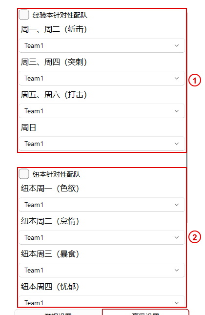
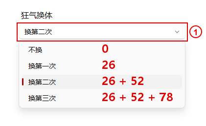
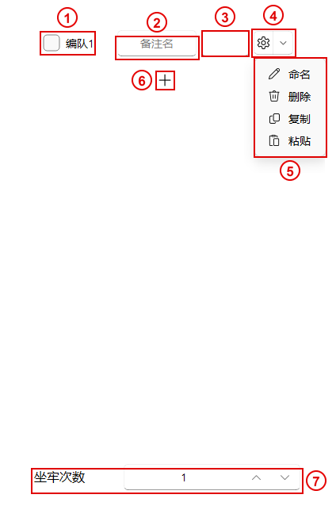
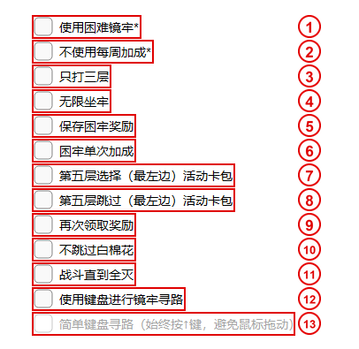
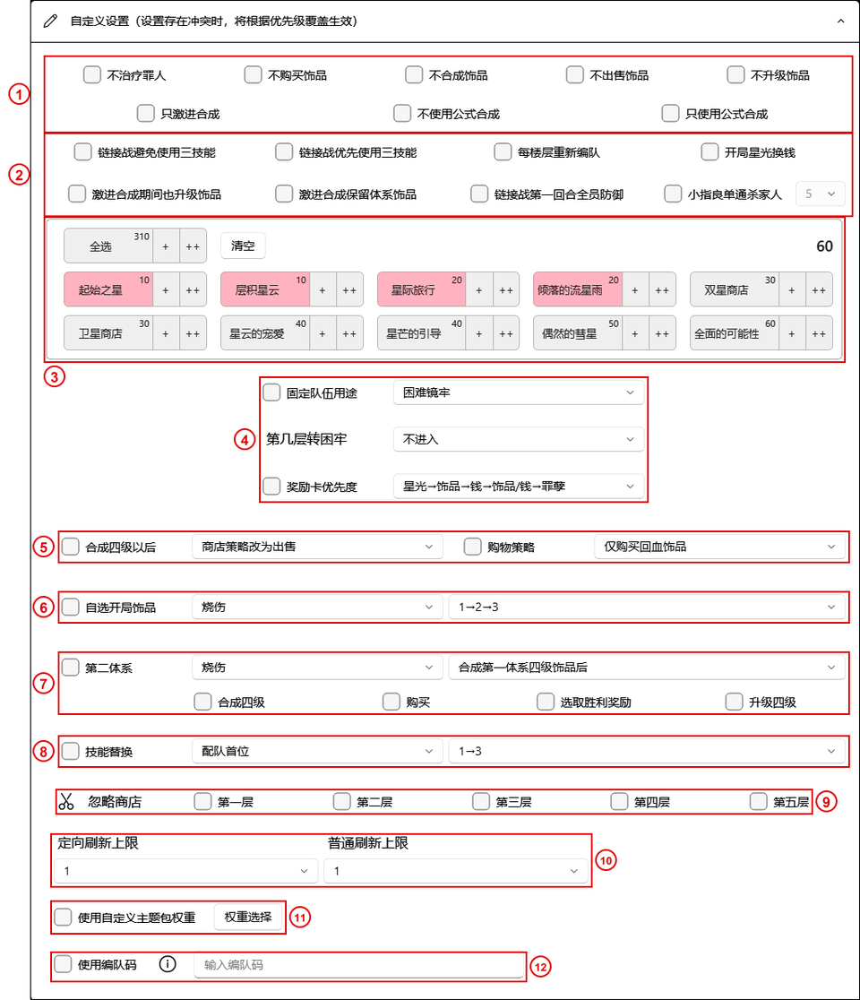

<div align="center">

# 用法详解

**简体中文** | [English](/assets/doc/en/How_to_use_EN.md)

[*项目说明*](/README.md) | [*常见问题*](/assets/doc/zh/FAQ.md) | [*README*](/assets/doc/en/README_EN.md) | [
*FAQ_EN*](/assets/doc/en/FAQ_EN.md)

</div>

<div align="center">

在脚本执行过程可以使用 **CTRL+Q** 按键终止脚本进程（此操作可能导致脚本再次启动时出现问题，可以通过重启脚本程序解决）

使用 **ALT+P** 可以暂停脚本，使用 **ALT+R** 可以恢复脚本

使用模拟器的方法在[本文最下方](#模拟器用法)

对于外部脚本的额外支持在 [三方脚本支持](#三方脚本支持)
</div>

---

## 主界面



#### ① 当前 AALC 的版本号，提 Issue 时请附上

#### ② 一键长草：主页面，所有自动化任务都在这里设置和启动

#### ③ 帮助：就是你现在看的这份文档

#### ④ 小工具：一些单独拆出来的小工具

#### ⑤ 设置：其他设置项，比如模拟器、自动困难模式、选择队伍方式（用队伍名还是队伍序号识别编队）、快捷键、更新等

#### ⑥ 勾选启动时要执行的任务（窗口设置始终执行；亚哈共鸣目前没有可设置的内容）

#### ⑦ 点击齿轮切换到对应任务的设置页（各页说明见下文）

#### ⑧ 全选 / 清空所有任务

#### ⑨ 任务全部结束后做什么，点"编辑"修改，详见[之后](#之后)

#### ⑩ 开始执行勾选的任务；运行中会变成停止按钮，旁边出现暂停按钮

#### ⑪ 游戏窗口分辨率，按电脑配置选择（建议 1920\*1080 或 2560\*1440）

#### ⑫ 游戏窗口位置。选"无限制"时不移动窗口；选其他位置时，窗口会被移到对应位置并去掉标题栏

#### ⑬ 结束后恢复窗口：任务结束后恢复游戏窗口的标题栏、取消置顶

#### ⑭ 每个任务的设置页都分"常规设置"和"高级设置"两部分

#### ⑮ 日志栏

##### Tips: 窗口位置选"无限制"时，结束后恢复窗口不起作用

---

### 窗口设置 · 高级设置



#### ① 截图间隔：两次截图之间的最短间隔（秒）

#### ② 鼠标活动间隔：两次鼠标操作之间的最短间隔（秒）

#### ③ 鼠标按下持续时间：鼠标按下后多久松开，只在 ④ 选"是"时生效

#### ④ 使用异步方法进行键鼠输入：能提高点击速度，但电脑配置或网络较差时可能漏点

一般保持默认即可；电脑较慢时可以适当调大 ① ②。

---

### 之后



点主界面"之后"旁边的"编辑"打开：

- **前置动作（可多选）**：退出游戏、退出模拟器（仅模拟器模式）、退出 AALC
- **最终动作（单选）**：无、睡眠、休眠、锁屏、关机（关机会在 30 秒后执行）
- **仅本次生效**：只对这一次运行有效，重启 AALC 后恢复为"无"
- **保存为默认**：以后每次运行结束都执行

先执行前置动作，再执行最终动作。如果还有排队等待的定时任务，这次的收尾动作会跳过。

---

## 日常任务



#### ① 经验本次数

#### ② 纽本次数（先打完经验本，再打纽本）

#### ③ 使用的编队，经验本和纽本都用这个编队

#### ④ 使用连续作战，右边选择每次最多连续打几场。比如总共 5 次、上限 3 场，会分成 3 场 + 2 场

### 日常任务 · 高级设置



#### ① 经验本针对性配队：按星期给不同属性的经验本配置编队，不勾选则使用常规设置里的编队

#### ② 纽本针对性配队：按星期给不同的纽本配置编队，不勾选则使用常规设置里的编队

---

## 领取奖励


勾选需要领取的奖励，可多选；全都不勾时跳过这个任务。

#### ① 日常/周常：领取任务页里日常、周常、赛季任务的奖励

#### ② 通行证奖励：在通行证页面点"全部领取"

#### ③ 邮件：在邮箱里点"全部领取"

---

## 狂气换体



#### ① 每天狂气换体的次数。"换第 N 次"表示把当天第 1 到第 N 次都换掉，今天已经换过的不会重复换。每次消耗的狂气分别是 26、52、78，图中红字是累计消耗

### 狂气换体 · 高级设置


#### ① 葛朗台模式：等下一点体力的回复时间剩 5 分 20 秒以上时，才把狂气换成体力，避免浪费回复进度

#### ② 不自动兑换脑啡肽：勾选后，战斗和镜牢结束后不再自动把体力换成脑啡肽（狂气换体任务本身仍会兑换）

---

## 坐牢设置



#### ① 勾选表示启用此编队。启用的编队按勾选的先后排队，轮流用于镜牢

#### ② 此编队的备注名，只用于显示，可以在 ⑤ 里修改

#### ③ 此编队当前的执行次序。每次镜牢使用排在第一的编队，完成后它排到队尾

#### ④ 点击齿轮，打开此编队的[队伍设置](#队伍设置)

#### ⑤ 点击齿轮右侧的箭头：命名（修改备注名）、删除（至少保留一个编队）、复制、粘贴（把一个编队的设置复制到另一个编队）

#### ⑥ 添加编队：可以创建空白编队，也可以从导出的配置文件创建

#### ⑦ 坐牢次数：要完成的镜牢次数

### 坐牢设置 · 高级设置



#### ① 使用困难镜牢\*：每次镜牢都打困难难度

#### ② 不使用每周加成\*：结算时不使用每周奖励加成

带 \* 的两项只在本次运行期间有效，重启 AALC 后自动取消；**右键点击**可以设为永久生效。设置页开启"自动困难模式"后，AALC 会在每周困牢刷新后自动打困牢，此时 ① 由程序控制

#### ③ 只打三层：到第四层时放弃本次镜牢

#### ④ 无限坐牢：忽略坐牢次数，一直打下去

#### ⑤ 保存困牢奖励：只在困难镜牢时生效，只打一次，结算时不消耗体力领取，把奖励留着

#### ⑥ 困牢单次加成：结算时只使用一次每周奖励加成

#### ⑦ 第五层选择（最左边）活动卡包：第五层直接选最左边的主题卡包

#### ⑧ 第五层跳过（最左边）活动卡包：第五层不选最左边的卡包，从其余卡包里按权重选择（和 ⑦ 同时勾选时 ⑦ 优先）

#### ⑨ 再次领取奖励：完成第一次镜牢后、以及全部镜牢结束后，各执行一次"领取奖励"任务

#### ⑩ 不跳过白棉花：默认会跳过流血体系的饰品"白棉花"，勾选后不再跳过

#### ⑪ 战斗直到全灭：默认在有罪人阵亡、或可出战人数不足时放弃并重开，勾选后一直打到底

#### ⑫ 使用键盘进行镜牢寻路：用方向键代替鼠标点击来选择下一个节点

#### ⑬ 简单键盘寻路：始终按 ↑ 键前进，不用鼠标拖动地图，失败时退回普通寻路；需要先勾选 ⑫

---

## 队伍设置

在坐牢设置里点编队的齿轮，顶部会多出"队伍设置"页面：


#### ① 选择队伍名称：镜牢时在游戏里选哪个编队（Team1 对应游戏里的"编队#1"）。游戏里的编队需要保持默认名称；如果改过名，请在设置页把"选择队伍方式"改为"使用队伍序号"

#### ② 选择队伍体系：决定获取、购买、合成饰品时优先哪个体系

#### ③ 选择商店策略：出售（不合成，卖掉无用饰品）、合成、合成：四级优先（优先合成本体系的四级饰品）

#### ④ 点击罪人选择上场人员，按点击顺序编号：前 7 个是上场人员（SELECTED），之后的是替补（BACKUP）

#### ⑤ 舍弃的体系：勾选的体系的饰品会被出售，或者在合成时当作素材

#### ⑥ 自定义设置，展开后见下图

#### ⑦ 观测 EGO 饰品：勾选"启用观测"后，按体系、等级、所在行、所在列指定最多 3 个开局要观测的饰品

#### ⑧ 编队统计数据：此编队的镜牢次数和平均用时

#### ⑨ 导出设置 / 导入设置：把此编队的设置（包括主题包权重）导出为文件，或从文件导入

#### ⑩ 取消 / 保存：只有点"保存"后修改才会生效

### 自定义设置



#### ① 商店和合成：不治疗罪人、不购买饰品、不合成饰品、不出售饰品、不升级饰品；只激进合成、不使用公式合成、只使用公式合成

#### ② 战斗和流程：

- 链接战避免使用三技能 / 链接战优先使用三技能（二选一）
- 每楼层重新编队：每层选完主题包后重新编队
- 开局星光换钱：进入镜牢时把星光换成钱
- 激进合成期间也升级饰品；激进合成保留体系饰品（激进合成时不用本体系饰品当素材）
- 链接战第一回合全员防御 / 小指良单通杀家人（二选一）：后者会在每次镜牢中连续若干回合全员防御，回合数在右侧选择

#### ③ 开局星光：选择进入镜牢前要点的星光加成，右上角显示总消耗

#### ④ 固定队伍用途：此编队只用于困难镜牢或普通镜牢；第几层转困牢：到达指定层时切换到困难主题包；奖励卡优先度：选择奖励卡的顺序

#### ⑤ 合成四级以后：合成出本体系四级饰品后，改为出售、普通合成、合成第二体系四级饰品或跳过商店；购物策略：选择在商店里买哪些饰品

#### ⑥ 自选开局饰品：开局饰品使用指定的体系和选择顺序

#### ⑦ 第二体系：指定第二个体系，以及从什么时候开始、对它做哪些操作（合成四级、购买、升级四级等）

#### ⑧ 技能替换：在商店里给指定的罪人替换技能

#### ⑨ 忽略商店：勾选的楼层不进行商店操作

#### ⑩ 定向刷新上限 / 普通刷新上限：每个商店最多刷新几次

#### ⑪ 使用自定义主题包权重：选主题包时使用此编队自己的权重，点"权重选择"设置

#### ⑫ 使用编队码：在游戏里加载编队码，会覆盖游戏里原有的编队配置，后台模式下可能不稳定

---

# 模拟器用法

设置界面中，开启“使用模拟器”选项，推荐使用MUMU模拟器。

### 模拟器端口号的选择与获取

#### mumu模拟器：模拟器右上角菜单栏——问题诊断——查找“ADB调试端口”

- 如果使用默认的端口号0，则使用默认建立的初始模拟器

#### 其他模拟器：根据自身情况查找端口号，以下为一些默认端口

- 雷电模拟器 5555
- 蓝迭模拟器 5555
- 逍遥模拟器 21503
- 夜神模拟器 62001 / 59865

### 注意

- 不同的模拟器，端口号可能不同，需要根据实际情况选择
- 不同的模拟器，可能需要在设置中开启adb端口调试功能，如蓝迭模拟器, 雷电模拟器
- 使用mumu模拟器需关闭“应用保活”功能，否则会导致脚本无法正常运行（已配置自动关闭功能，但可能失效）
- 使用模拟器的时候，需使模拟器的分辨率与AALC中“窗口设置”里的分辨率保持一致
- 模拟器可能会导致脚本运行缓慢，建议使用较高配置的电脑，并给予模拟器足够的内存和CPU资源

# 三方脚本支持

## 命令行启动

启动方式:

```ps1
# <> 内为必填内容
# [] 内为可选参数
# 不加括号的根据对应指令描述填写
AALC.exe <command_name> command_args extra_args

# 以下不写 "AALC.exe"
```

目前支持的指令:

- `start [--exit [int]]`
  - `start`
    AALC启动后自动运行任务, 需要提前设置任务内容
  - `[--exit]` 可选参数, 附带一个额外参数
    - `[int]` 一个`int`字符串, 含义为 AALC 长草界面 `combobox` 的索引, 如果不填写默认为 `5` 即**退出AALC**

示例: `AALC.exe start --exit 6`

在当前版本会在结束后退出AALC与游戏
